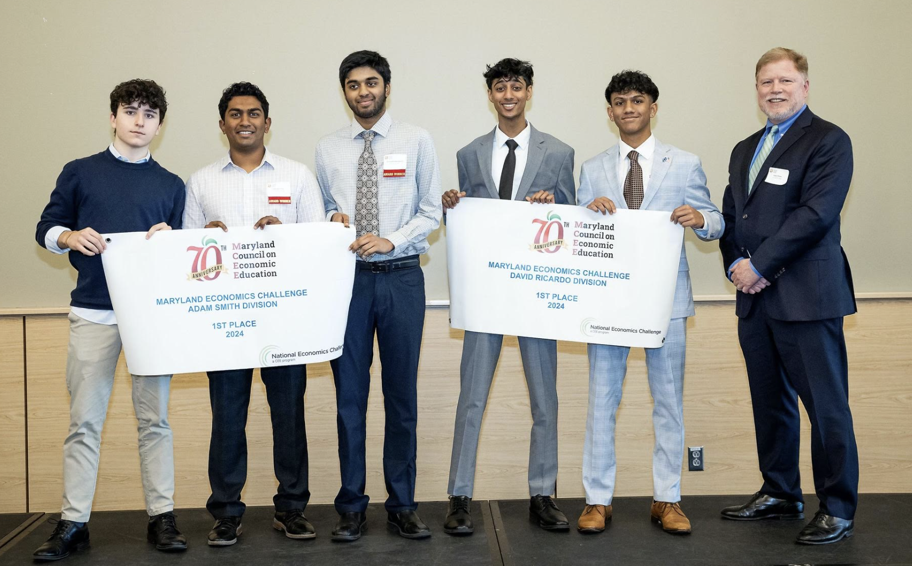

I captained the Mount Hebron High School Economics Team in 2023–2024. The team represented the United States at the 2024 International Economics Olympiad in Baku, Azerbaijan. As captain I taught college-level economics to 40+ members, ran training sessions, and led recruitment and member selection.

## Results

| Year | Result |
| --- | --- |
| 2024 | International Economics Olympiad, individual bronze medal |
| 2024 | Upper Division International Economics Champions vs. China |
| 2024 | Lower Division International Economics Champions vs. China |
| 2024 | Upper Division National Economics Challenge, 1st |
| 2024 | Lower Division National Economics Challenge, 1st |
| 2023 | Harvard International Economics Challenge, finalist (2nd) |
| 2023 | Lower Division National Economics Challenge, 1st |
| 2023 | Lower Division International Economics Champions vs. China, 1st |
| 2023 | Northwestern International Economics Tournament, finalist |
| 2023 | Euro Challenge, finalist (2nd) |
| 2022 | Upper Division National Economics Challenge, finalist (2nd) |
| 2022 | Lower Division National Economics Challenge, finalist (3rd) |
| 2021–2024 | Maryland State Champions (4 years) |

Also: CNBC interview with Steve Liesman. TODO: link to the CNBC interview and one line on what it covered.

*Maryland Economics Challenge 2024: first place, Adam Smith and David Ricardo divisions.*
