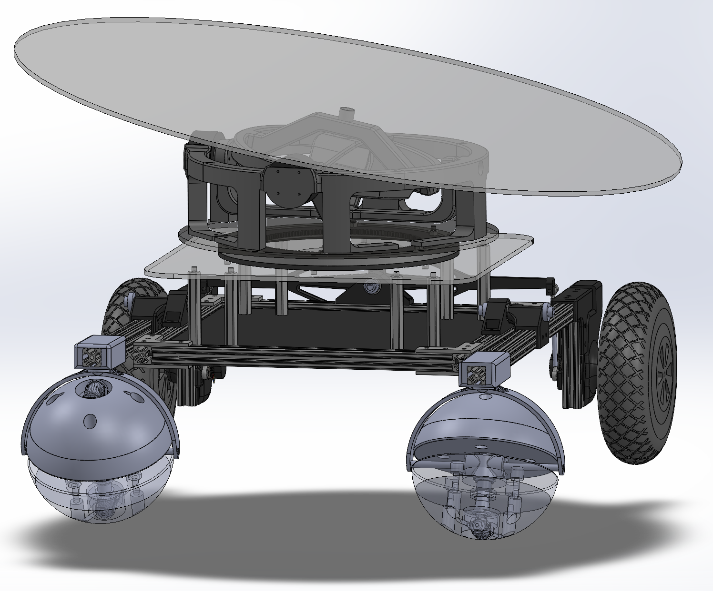
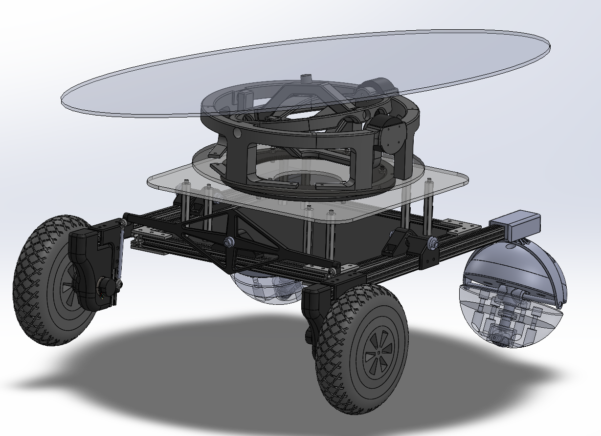
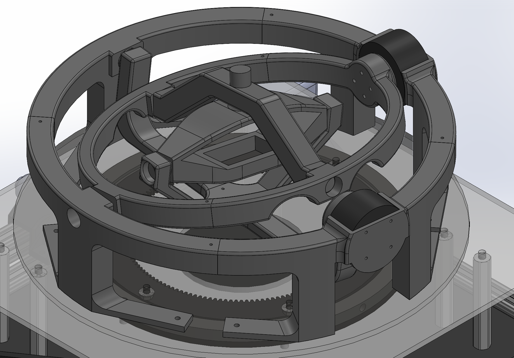
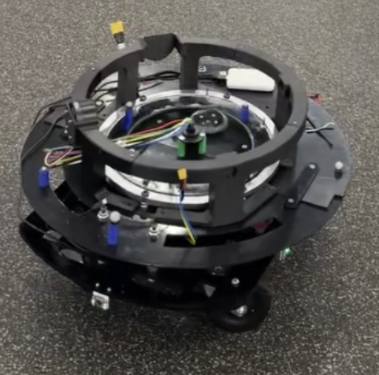
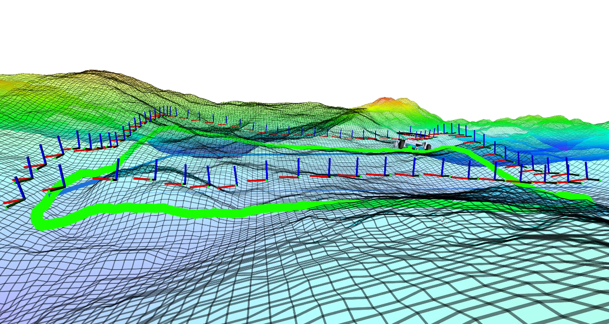
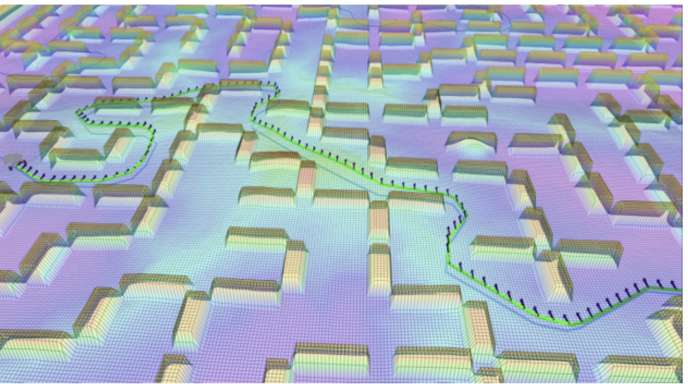

I work on the Holonomic Affordable Multi-Terrain Robot (HAMR) at Mark Yim's ModLab, on the mechanical stack that makes holonomic turret control work off-road: a rocker-bogie-style suspension and a three-axis stabilized gimbal.

## System

- **Suspension.** The rocker linkage ties the left and right wheel pairs so both sides keep ground contact while the chassis rides over terrain discontinuities. This preserves traction and keeps drive loads predictable for control.
- **Gimbal.** A layered gimbal decouples the payload from chassis motion. Roll and pitch are actively stabilized; the yaw turret holds a commanded heading.
- Joints sized for stiffness and travel, continuous-rotation actuators with IMU and encoder feedback, tuned for ±20–30° effective attitude range under payload.

## My contributions

- Rocker geometry and wheel/caster selection.
- Gimbal assembly: increased range, reduced backlash through coaxial layer stacking, and placed the turret's center of mass on the yaw axis. This reduces cross-axis coupling (yaw commands tilting the plate) and stick-slip when the rocker articulates over steps.
- Caster concepts (ball and deformable) to avoid edge catch at obstacle impact, a known limitation of off-road holonomic wheeled platforms.
- Enclosure and rail updates for a stiffer frame.

TODO: robot mass, payload mass, step height cleared, backlash before/after.

*HAMR 3.0 (rocker + casters).*

[HAMR 3.0 video](https://drive.google.com/file/d/1eZZQwF9MmJKsE1gVVql_hR_leqOnINQe/view)

*Gimbal mechanism.*

*Working HAMR 2.0.*

## Simulation and validation

The design was validated in ROS/Gazebo before hardware bring-up.

- URDF built from CAD, with 2.5D heightmaps for uneven terrain.
- Jacobian-based velocity controller mapping turret-frame twist to wheel and turret rates.
- Mobility-ellipsoid analysis to visualize holonomicity.
- Square, triangle, and circle paths and maze planners (PRM/A*) to check heading control under rocker motion.

In simulation reviews and Vicon lab tests, the stabilized gimbal held the plate near level while the base conformed to terrain. The same ROS nodes bridged simulation and hardware, and the results informed feedforward and gimbal-smoothing updates for the next mechanical/electrical revision.

*Mapping TFs throughout the trajectory.*

*Maze navigation in simulation with PRM/A\*.*

TODO: re-add the figure "Canonical holonomicity tests in simulation: square, triangle, and circle trajectories" — it could not be downloaded from the old site.
