In spring 2025 I was selected for the Quantum Space Kerry Wisnosky internship, a fully funded mechatronics internship given to one Penn Engineering student per year. Over the summer I worked on the Mini Piccolissimo (MiniP), the smallest single-actuator drone in the world, originally designed and built at Mark Yim's ModLab. My focus was the wing frame, propeller geometry, and the relationship between propulsion and drag.

## Wing frame and inertial analysis

I built a coupled Ansys FEA/CFD workflow that links structural stiffness with aerodynamic loading to predict flight behavior at millimeter scale. The 34 mm baseline hovered but had no lateral control. The target was a 27.8 mm variant with stable flight and active lateral control.

Changes across successive builds, guided by simulation and benchtop center-of-mass and moment-of-inertia checks:

| Change | Reason |
| --- | --- |
| Two-battery layout | Symmetric mass placement |
| Mass trimmed | Accepting shorter flight time |
| Motor offset 2.2 mm → 3.0–3.3 mm | Control authority |
| Shorter shaft | Mitigate MoI-driven flip instability |
| Refined wing planform and stiffness, material tests | Structural/aero coupling |

Flip time increased and overall stability improved over the builds.

TODO: flip-time numbers before and after, final diameter and mass, flight time.

To quantify these sensitivities I swept geometry and mass placement, computed the resulting inertia tensors, and modeled induced moments about the thrust axis to generate a labeled dataset. An ML model trained on it maps inertia and placement features to a stability score. Three rules came out of it:

1. Match the in-plane inertias.
2. Minimize the offset between thrust axis and center of mass.
3. Avoid large cross-terms.

These drove the layout choices above: symmetric battery placement, modest motor offset, shorter shaft.

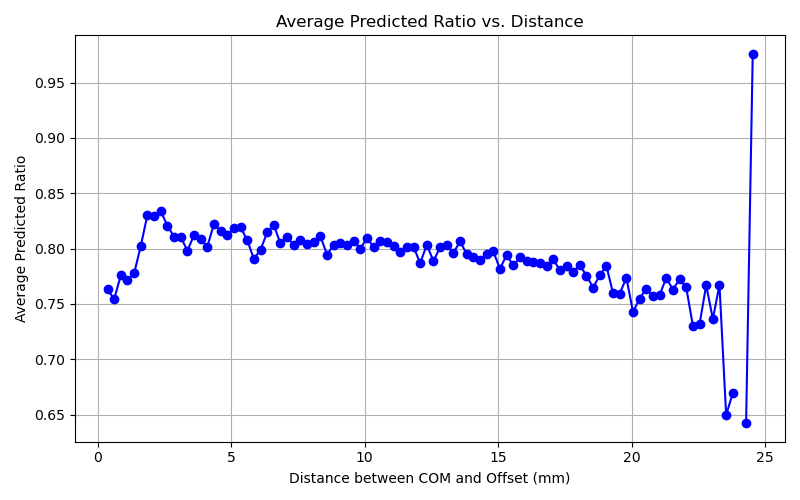

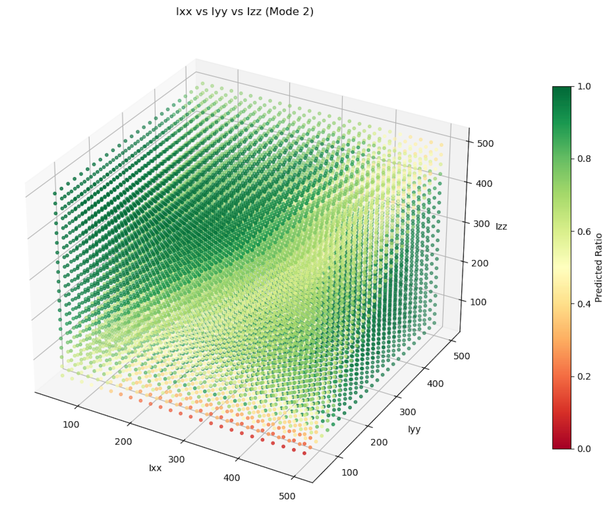
*Inertial ratios.*

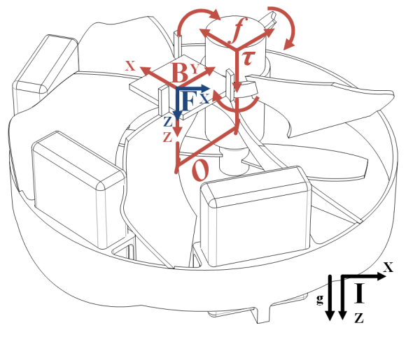
*MiniP design.*

## Propeller geometry

At millimeter scale, small geometry changes have large effects on lift-to-drag, so the team set up an experiment-in-the-loop Bayesian optimization: propose a design, print it, test it, update the model, repeat.

**Design space** (kept small so prints stay fast): camber and a symmetric-camber option, root and tip chord, corner radius, surface roughness and print-layer direction, inflow vs. counter-flow orientation, angle of attack, and twist angle.

**Test rig**: a CX-Star 12 mm motor on a 6-axis thrust/torque sensor, with a custom IR emitter/receiver for RPM. A synchronized logger let us test each propeller at matched operating points; calibration and repeat runs kept noise low enough to resolve small geometry differences.

**Loop**: a surrogate model of L/D versus geometry and operating state, with an acquisition function choosing the next print. Trials concentrated where gains were most likely, and the results gave practical rules: useful camber ranges, twist–angle-of-attack coupling, when print-layer direction and roughness help, and limits set by corner radius and chord ratio.

TODO: number of iterations, baseline vs. best L/D, final propeller parameters.

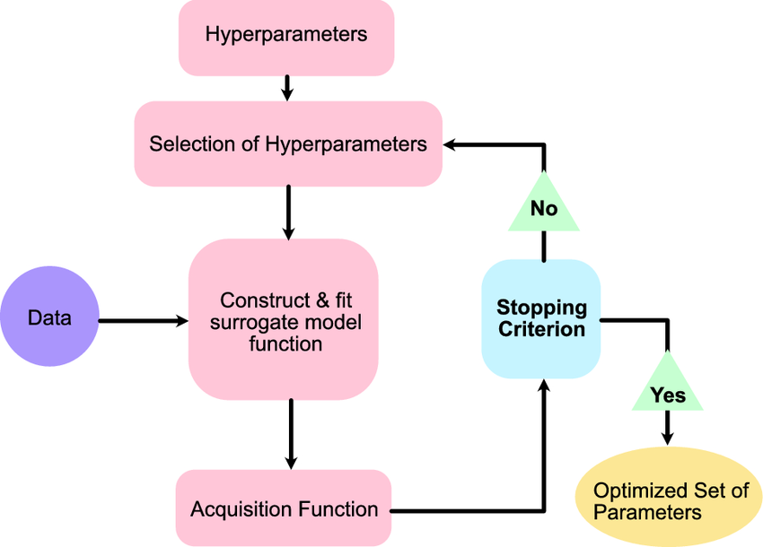
*Bayesian optimization process.*

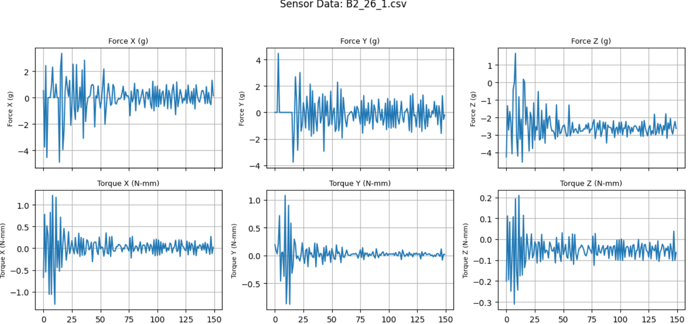
*Torque and thrust readings.*

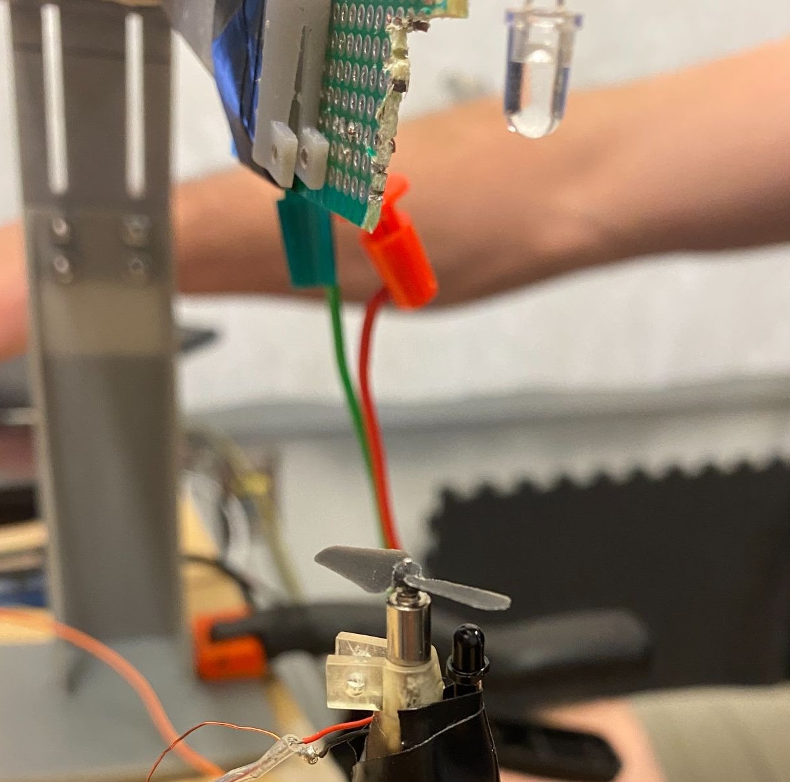
*Test rig and sensor attachment.*

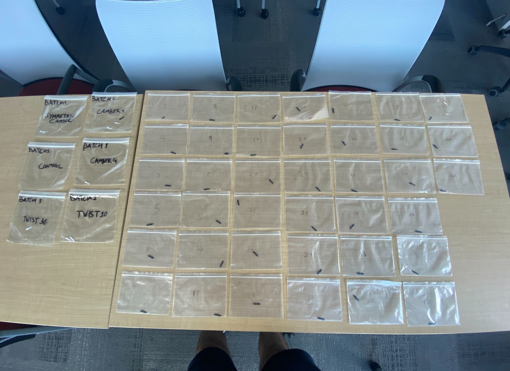
*Propeller prints.*

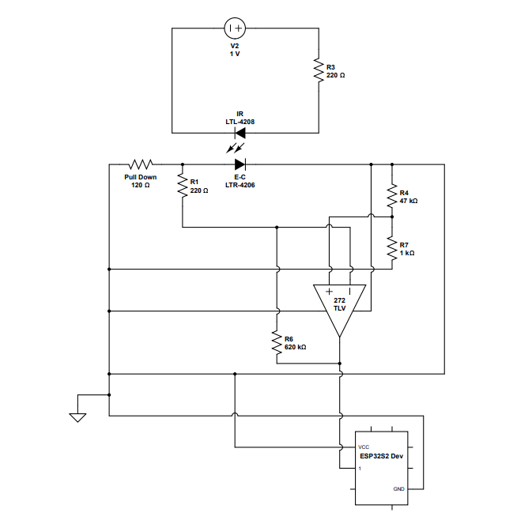
*Custom RPM sensor schematic.*

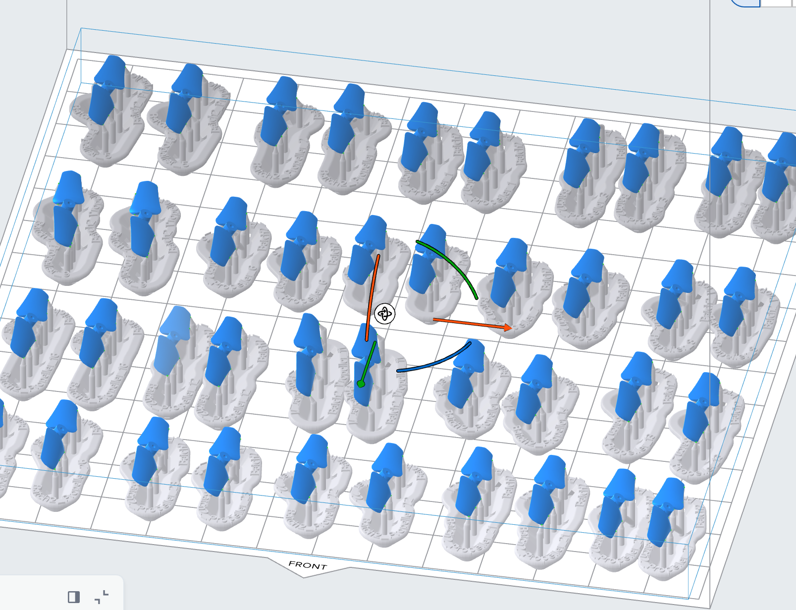
*Propeller iterations.*

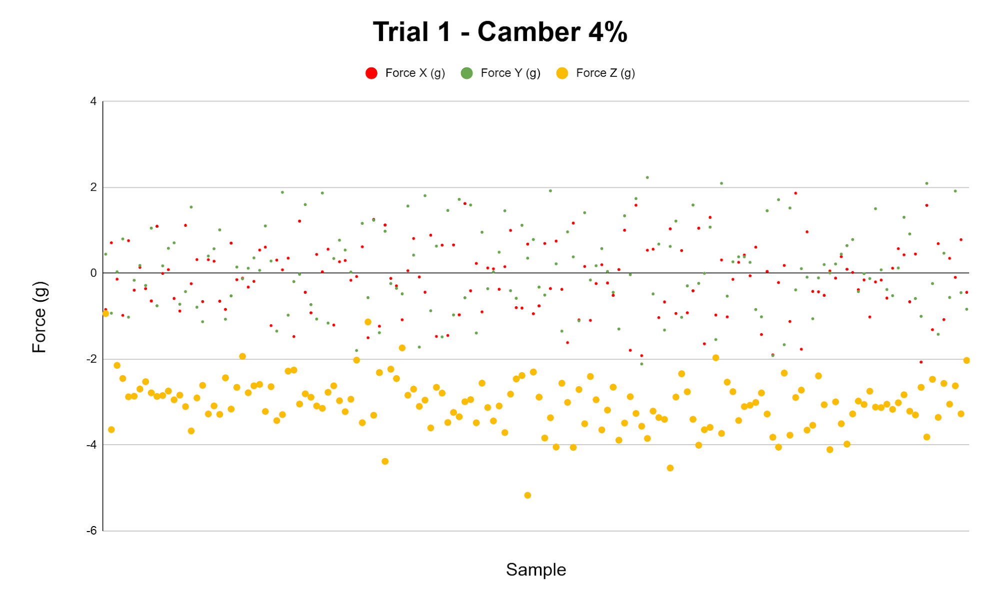
*Thrust readings in x, y, z.*

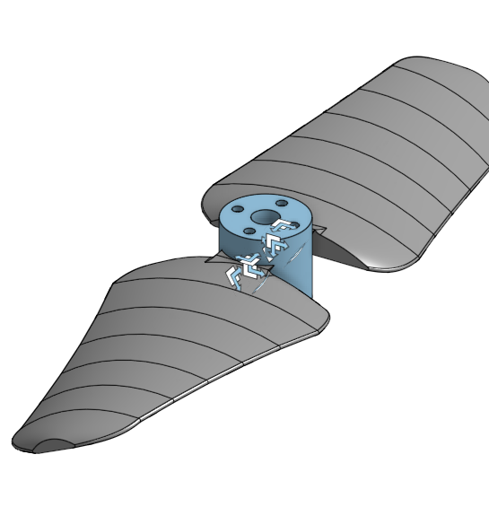
*Propeller design.*
