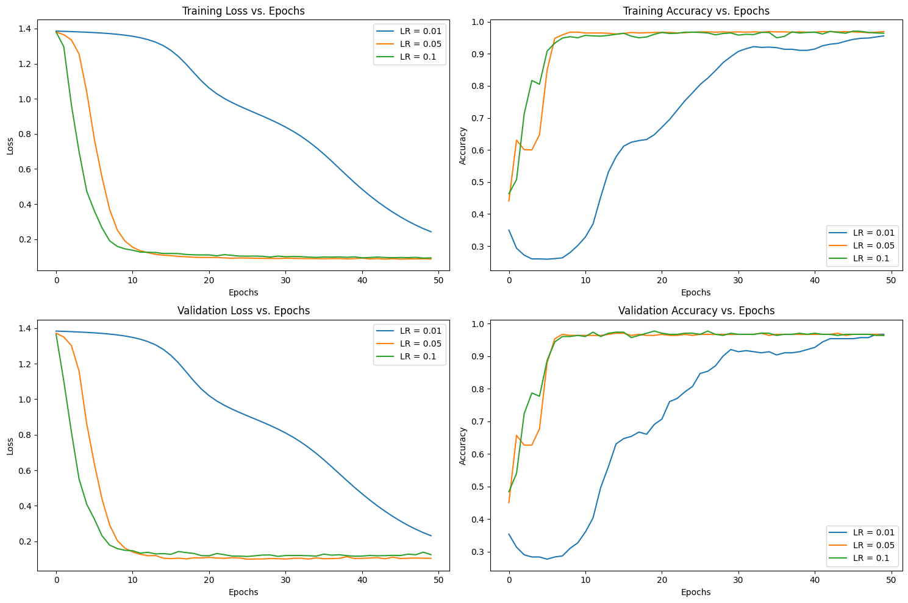

## CIS 5450: Big Data Analytics (graduate)

**Question:** can Middle East geopolitical conflict signals predict next-day WTI crude oil returns?

- Joined ACLED armed-conflict event data with WTI futures prices into a **50,175-row country-day panel** covering 15 countries and 3,349 trading days.
- Features: lagged oil returns, event counts, fatalities, event-type indicators, oil-infrastructure mentions, country fixed effects, day-of-week controls.
- Models: OLS, Ridge, Lasso, Random Forest, Gradient Boosting, and classifiers, all on chronology-safe splits.
- Evaluation: MAE, RMSE, $R^2$, directional accuracy, AUC, permutation testing, feature importance, bootstrap confidence intervals.

**Result:** lagged oil-return structure dominated the feature space. Conflict-based predictors showed weak, statistically unconfirmed signal. Gradient Boosting reached about **50.5% directional accuracy**, but its confidence interval overlapped the 50% baseline.

The course also covered relational modeling, SQL/DuckDB query optimization, Pandas and Polars workflows, Spark and MapReduce, partitioning, replication, joins at scale, Bloom filters, hashing, and NoSQL tradeoffs, with an emphasis on how storage and execution choices affect analytics and ML performance.

## CIS 5190: Applied Machine Learning (graduate)

**Task:** classify short headlines as NBC or Fox News, on a cleaned dataset of 3,799 examples.

- Pipeline: preprocessing, label extraction from URLs, de-duplication and noise removal.
- Compared TF-IDF logistic regression, SVM/SGD, random forests, MLPs on SVD-reduced features, soft-voting and stacking ensembles, and fine-tuned BERT.
- Final model: hashed word- and character-level TF-IDF features with separate normalization, and a linear SVM-style classifier exported as a PyTorch checkpoint.

**Result: 84.3% test accuracy, top 10% of the class,** beating BERT on this small, style-heavy dataset. Character-level features captured source-specific tone and formatting better than deeper models trained on limited data.

The course covered linear and logistic regression, regularization, gradient descent, neural networks, kNN, trees and boosting, CNNs, RNNs, attention and transformers, K-means and PCA, and reinforcement learning (MDPs, Q-learning, policy methods).

## ESE 2030: Linear Algebra and Applications of AI

### Latent semantic analysis of US inaugural addresses

Turned every US presidential inaugural address into TF-IDF features, then used truncated SVD to compress thousands of terms into a few interpretable themes. A 2-D embedding showed clusters by era; a 10-D representation gave a more reliable similarity measure for a document-to-document correlation heatmap. Components were interpreted by reading their top-weighted words.

### Neural net soccer position classifier

A from-scratch neural network classifying synthetic soccer players by position.

- 1,500-row generated dataset with position-specific distributions for pace, shooting, passing, dribbling, defending, and physicality.
- ReLU hidden layers, softmax output, cross-entropy loss, mini-batch gradient descent.
- Learning-rate sweep over 0.01, 0.05, 0.1; loss and accuracy tracked over 50 epochs; confusion matrix and first-layer weight visualization.

The softmax and cross-entropy pair used:

$$
\hat{y}_k = \frac{e^{z_k}}{\sum_j e^{z_j}}, \qquad
\mathcal{L} = -\sum_k y_k \log \hat{y}_k, \qquad
\frac{\partial \mathcal{L}}{\partial z_k} = \hat{y}_k - y_k
$$

Findings: standardization and a sensible learning rate were necessary for stable training, and the confusion matrix showed realistic overlaps (midfielders vs. forwards).

### Also

K-means and PCA on a breast-cancer dataset; a trained tree classifier.

TODO: final test accuracy for the soccer classifier at each learning rate.

*Neural net training and validation curves for learning rates 0.01, 0.05, 0.1.*
