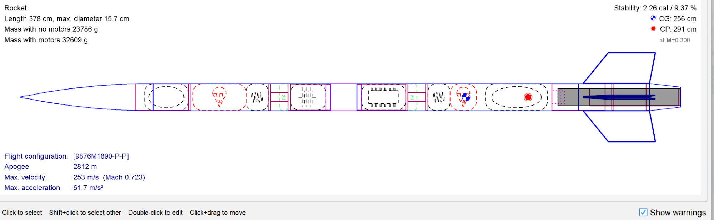
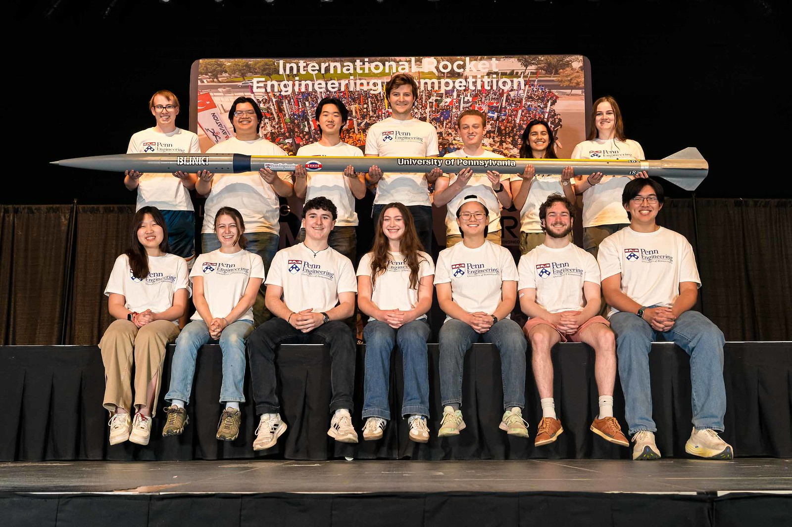
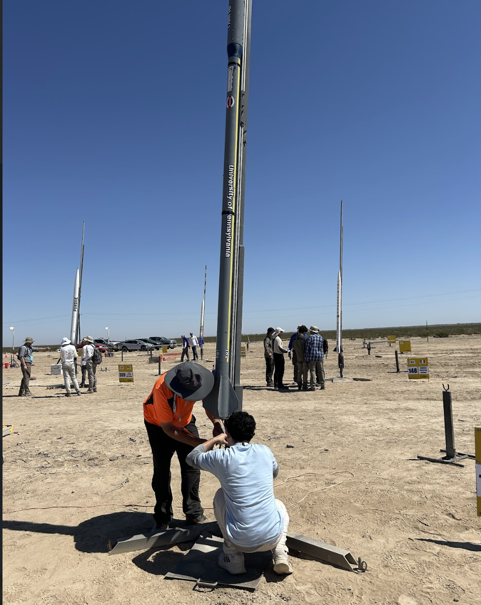

## 2025–26: Fin Can subteam lead

I lead the Fin Can subteam, connecting analysis to a repeatable build process.

- Ran RASAero and OpenRocket trade studies to set stability margins and ascent loads.
- Completed a flutter analysis in MATLAB, modeling flights to find critical flutter velocity and sizing fin thickness, sweep, and other parameters from it.
- Designed and built a dedicated alignment jig and wrote a documented layup workflow (prep, ply order, cure, checks) so the fin can is manufacturable at scale.

TODO: flutter model used (e.g. NACA TN 4197), fin material and layup schedule, critical flutter velocity vs. max flight velocity, stability margin in calibers.

*2025–26 OpenRocket final simulation.*

## 2024–25: fin design and manufacturing

- Helped engineer the fin-can structure.
- Supported aerodynamic performance work in OpenRocket and RASAero.
- Used Ansys FEA and CFD to evaluate the fin can, boattail, and air-brakes.
- Executed epoxy layups.
- Designed and built my own H-impulse rocket for Level 1 certification.

*Team at the 2025 International Rocket Engineering Competition.*

*Team mentor and I setting the igniter at IREC 2025.*

## Mentoring

I mentored new members through the design and construction of their own L1 rockets, and taught rocketry, CAD, and software sessions.
