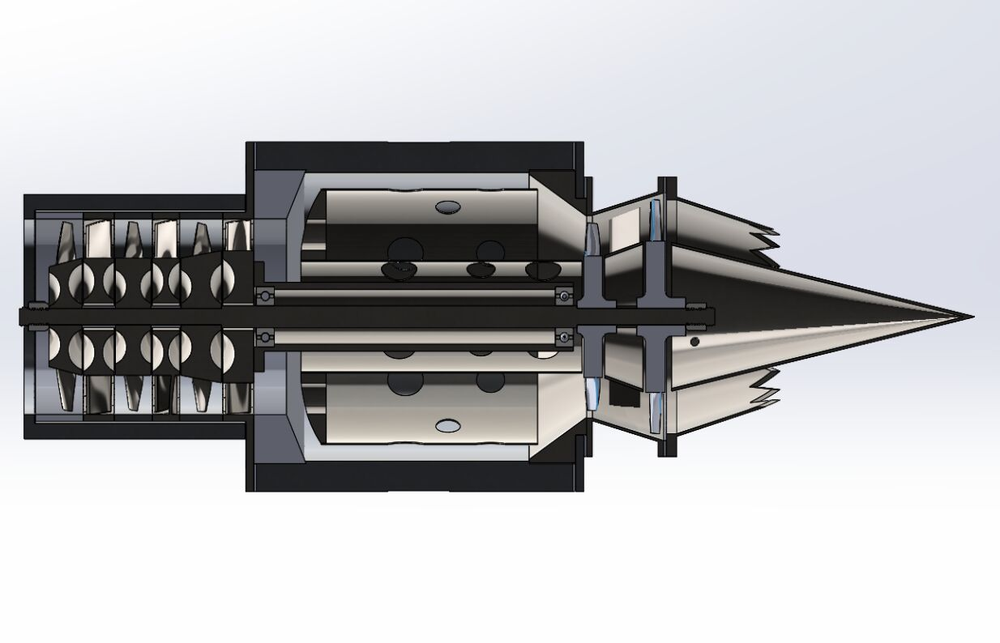
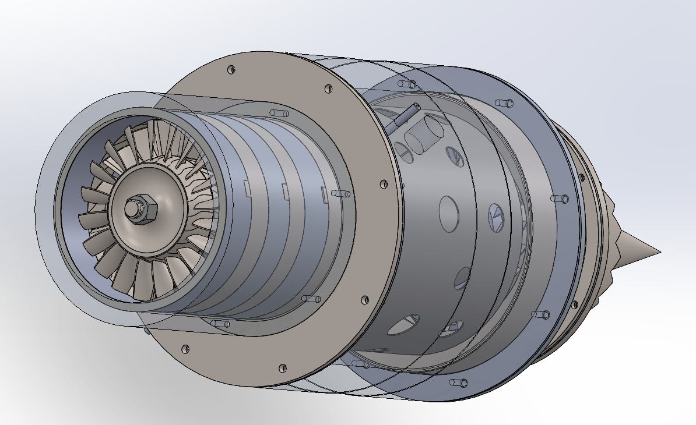
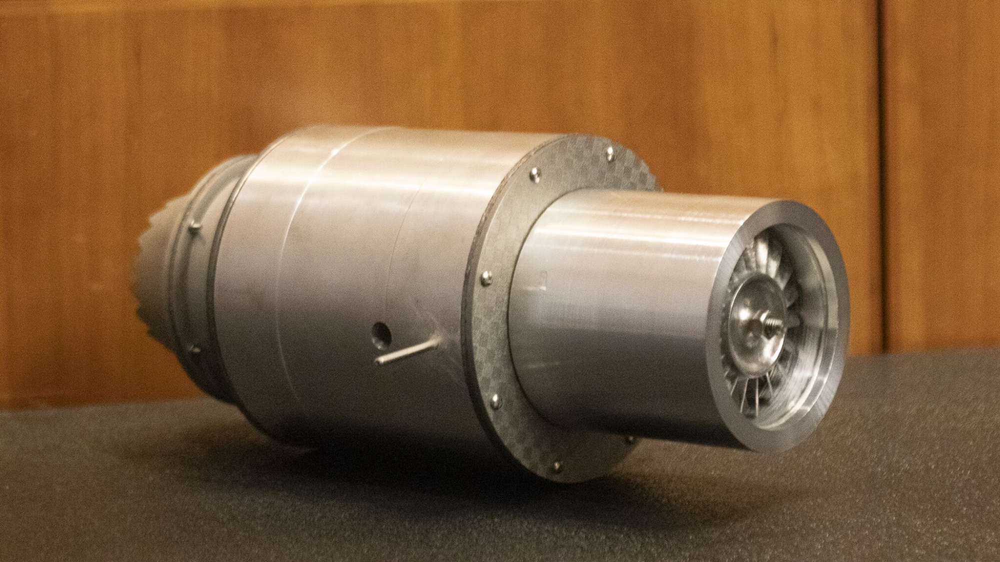
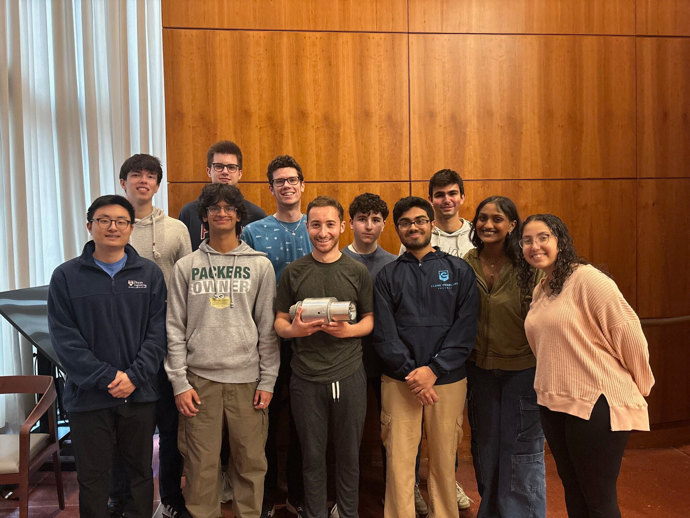

## Mark II: axial micro-turbojet

The Mark II was the first axial turbojet built by an undergraduate team in the United States. I designed and developed its kerosene fuel-injection system:

- Injector and manifold layout
- Basic sizing from combustor requirements
- Integration with the liner and the ECU start sequence

TODO: Mark II numbers — design thrust, RPM, fuel flow rate, injector count and orifice size, turbine inlet temperature, test results.

*Mark II section view.*

*Full Mark II CAD.*

## Mark III: hydrogen micro-turbofan

As combustor lead on Mark III I am taking a custom annular hydrogen combustor from concept to validated design.

- Defined airflow splits and flame stabilization concepts
- Reviewed dilution-hole patterns with outside experts and used CFD to develop the chamber
- Run structured design reviews and manage manufacturability and safety constraints
- Coordinate with the compressor and exit-nozzle teams

Mark III is still under development.

TODO: confirm architecture — the old site calls Mark III both a "radial turbofan" (heading) and an "axial micro turbofan" (body).

TODO: Mark III numbers — airflow split percentages, equivalence ratio, liner dimensions, CFD setup (solver, mesh size, combustion model), exit temperature profile, current status and test dates.

## Build and team

*Mark II build.*

*Mark II team.*
