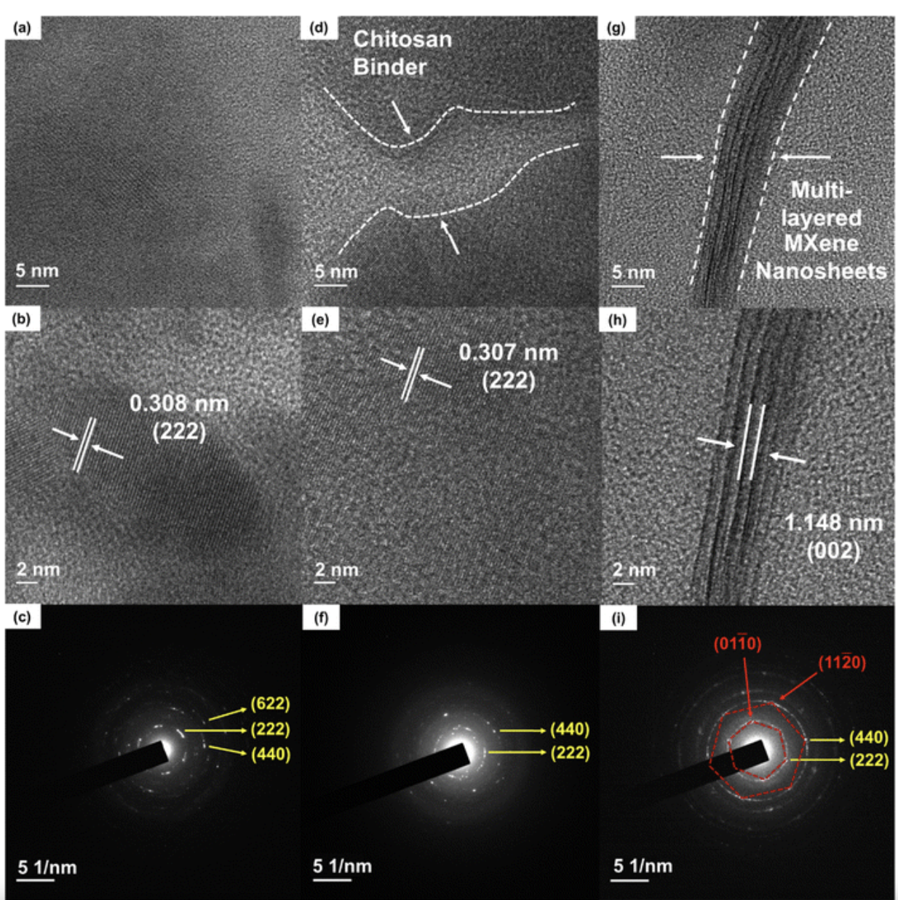
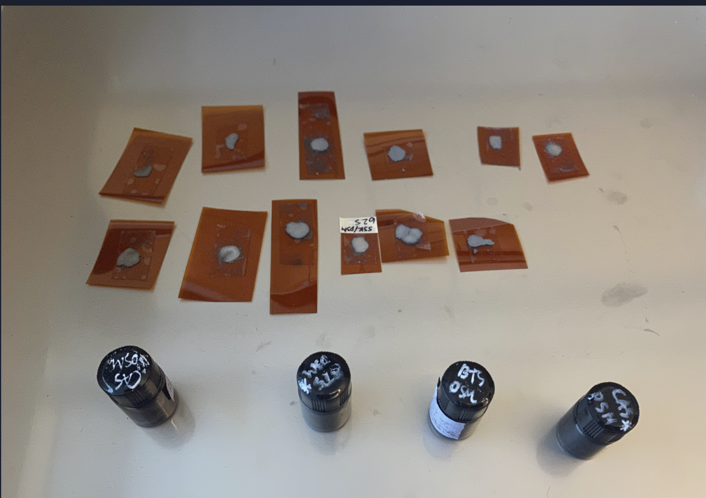
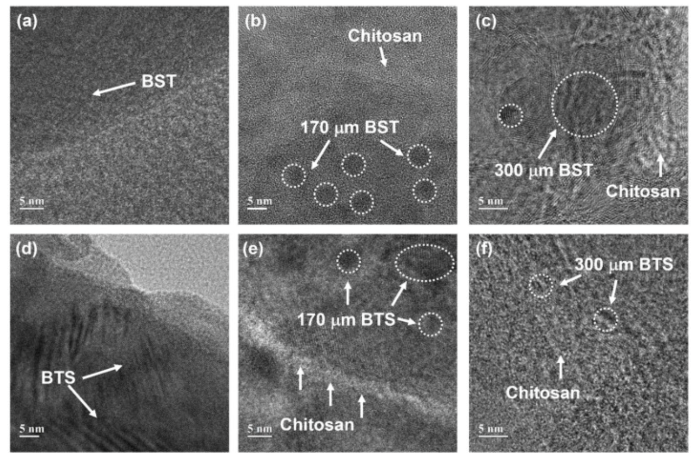
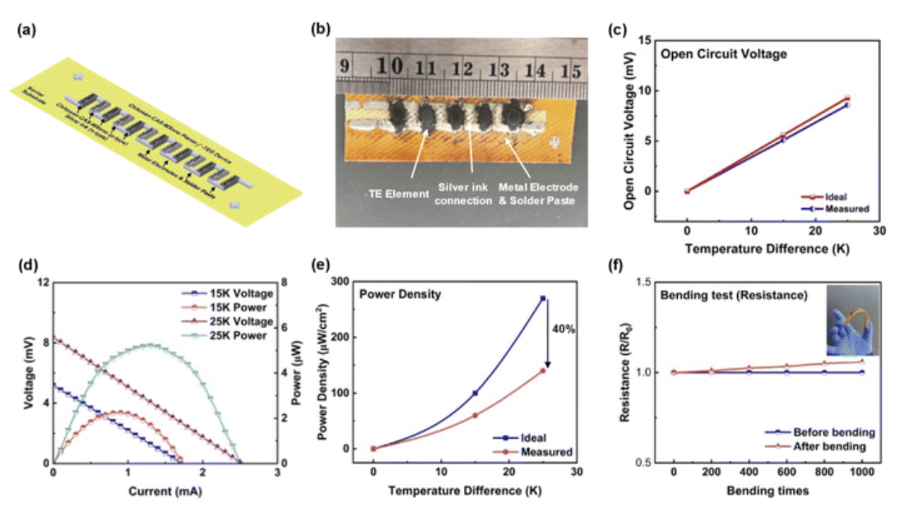

At the FlexMeshed Lab at UMBC with Prof. Deepa Madan, I designed and tested thermoelectric strips.

TODO: confirm institution — the old site title says "University of Maryland", the body says "UMBC".

## Thermoelectric films

- Refined a small test setup for Seebeck measurements.
- Processed conductivity data from Hall-effect testing in MATLAB.
- Iterated on strip geometry and fabrication steps to improve consistency.
- Characterized thermoelectric films with the goal of maximizing efficiency.
- Compared MXene-based formulations and inks under different processing conditions for their effect on electrical and thermal conductivity and device performance.

TODO: Seebeck coefficient, power factor, or conductivity values achieved; best formulation.

## Zinc batteries

In parallel I prepared zinc battery cells, ran basic cycling and impedance checks, and documented results to guide design changes.

*MXene CAS films showing the effect of chitosan binder.*

*BST and CAS films.*

*CAS power and chitosan CAS films tested for conductivity.*

*Thermoelectric strips.*
